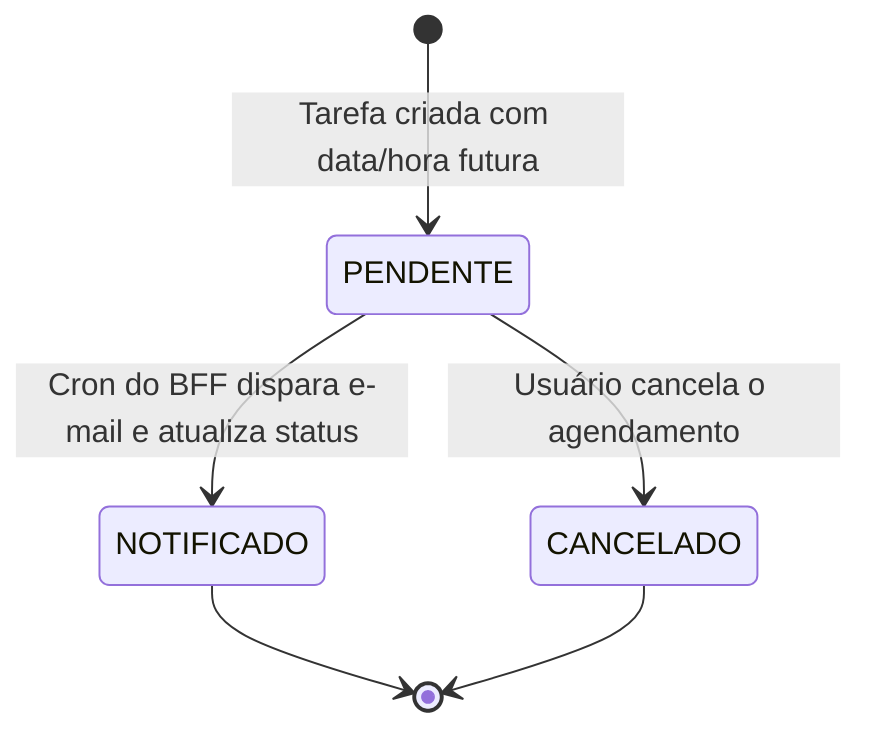

<div align="center">

# 📅 Microsserviço Agendador de Tarefas (`agendador-tarefas`)
### Core de Agendamento, Persistência NoSQL (MongoDB), CI/CD & SonarQube (90% Coverage)

[](https://openjdk.org/)
[](https://spring.io/projects/spring-boot)
[](https://www.mongodb.com/)
[](https://mapstruct.org/)
[](https://www.sonarqube.org/)
[](https://github.com/features/actions)

<p align="center">
  <b>Microsserviço de domínio central responsável pela criação, atualização, filtros temporais e máquina de estados das tarefas agendadas, utilizando persistência NoSQL de alta performance com MongoDB, mapeamento de DTOs com MapStruct e esteira de CI/CD integrada à inspeção estática no SonarQube.</b>
</p>

</div>

---

## 🌐 Ecossistema do Projeto (Navegação Polyrepo)

> Este microsserviço faz parte de uma arquitetura distribuída composta por **4 serviços autônomos**. Navegue pelos módulos:

| Microsserviço | Papel Arquitetural | Stack & Persistência | Porta | Repositório |
| :--- | :--- | :--- | :---: | :---: |
| 🛡️ **BFF Agendador** | Gateway, Orquestração OpenFeign, Swagger & Cron | Spring Boot 3, OpenFeign, Swagger | `8083` | [🔗 `bff-agendador-tarefas`](https://github.com/matheusrrtavares/bff-agendador-tarefas) |
| 👤 **MS Usuário** | Gestão de Identidade, JWT, JPA e API ViaCEP | Spring Security, JWT, PostgreSQL | `8080` | [🔗 `usuario`](https://github.com/matheusrrtavares/usuario) |
| 📅 **MS Agendador** | Core de Agendamentos, Status e Persistência NoSQL | Spring Data MongoDB, MapStruct | `8081` | 📍 **Você está aqui** |
| 📧 **MS Notificações** | Envio de E-mails Transacionais com HTML Dinâmico | JavaMailSender, Thymeleaf, SMTP | `8082` | [🔗 `notificacao`](https://github.com/matheusrrtavares/notificacao) |

---

## 🧠 Decisão Arquitetural: Por que MongoDB (NoSQL) neste Serviço?

Enquanto os dados de usuários e credenciais exigem integridade relacional estrita (ACID) no **PostgreSQL**, o agendador de tarefas adota o padrão de **Persistência Poliglota (*Polyglot Persistence*)** no **MongoDB**:
1. **Natureza Orientada a Documentos:** Cada tarefa é uma unidade de informação autocontida (datas de evento, descrição, status, dados do usuário).
2. **Consultas Temporais Rápidas sem Joins:** O BFF executa varreduras periódicas (*range queries*) por intervalos de datas (`dataEventoBetween`) para alimentar o motor de disparo; o MongoDB oferece altíssima velocidade de leitura e escrita para esse padrão.
3. **Evolução Flexível do Schema:** Facilidade para adicionar novos metadados à tarefa (ex: recorrência, tags, prioridades) sem necessidade de migrações complexas de tabelas.

---

## ⚙️ Máquina de Estados e Domínio

A tarefa transita pelos seguintes estados definidos em `StatusNotificacaoEnum`:



### Estrutura do Documento MongoDB (`TarefasEntity`):
* `id` (String / ObjectId)
* `nomeTarefa` (String)
* `descricao` (String)
* `dataCriacao` (LocalDateTime)
* `dataEvento` (LocalDateTime — data e hora agendada)
* `dataAlteracao` (LocalDateTime)
* `emailUsuario` (String — extraído do token JWT)
* `statusNotificacaoEnum` (`PENDENTE`, `NOTIFICADO`, `CANCELADO`)

---

## 🧪 Qualidade de Código, Testes & CI/CD (SonarQube 90%)

* **Testes Automatizados:** Suíte de testes unitários com **JUnit 5** e **Mockito** cobrindo regras de negócio da camada `Service` (criação de tarefa, alteração de status e validação de permissões).
* **Mapeamento Limpo com MapStruct:** Conversão performática entre `TarefasDTORequest`, `TarefasDTOResponse` e `TarefasEntity` sem código boilerplate manual.
* **Pipeline GitHub Actions & SonarQube:** Esteira automatizada a cada Push/PR executando `./mvnw clean verify` com análise estática de código no **SonarQube**, validando cobertura mínima de testes (**Quality Gate > 90%**) e prevenindo code smells e vulnerabilidades.

---

## 📡 Endpoints da API (Porta 8081)

| Método | Endpoint | Parâmetros | Descrição |
| :---: | :--- | :--- | :--- |
| `POST` | `/tarefas` | Body: `TarefasDTORequest` | Cria uma nova tarefa agendada |
| `GET` | `/tarefas/eventos` | Header: `Authorization: Bearer <JWT>` | Lista todas as tarefas do usuário autenticado |
| `GET` | `/tarefas` | Query: `dataHoraInicio`, `dataHoraFim` | Busca tarefas para disparo do Cron (chamado pelo BFF) |
| `PUT` | `/tarefas` | Body: `TarefasDTORequest`, Query: `id` | Atualiza os dados de uma tarefa |
| `PATCH`| `/tarefas` | Query: `status`, `id` | Atualiza o status (`NOTIFICADO`, `CANCELADO`) |
| `DELETE`| `/tarefas` | Query: `id` | Exclui uma tarefa agendada |

---

## 🚀 Como Executar

### 1. Subir o MongoDB (Docker)
```bash
docker run --name mongo-db -p 27017:27017 -d mongo:6.0
```

### 2. Configurar Variáveis de Ambiente (`application.yml`)
```yaml
spring:
  data:
    mongodb:
      uri: ${MONGODB_URI:mongodb://localhost:27017/db_tarefas}
jwt:
  secret: ${JWT_SECRET:minha-chave-secreta-jwt-de-teste}
```

### 3. Executar a Aplicação
```bash
git clone https://github.com/matheusrrtavares/agendador-tarefas.git
cd agendador-tarefas
./mvnw clean spring-boot:run
```

---

## 👨‍💻 Autor

Desenvolvido por **Matheus Rodrigues Rocha Tavares**  
*Backend Java Developer | Software Engineering B.S.*  
[LinkedIn](https://www.linkedin.com/in/matheusrrtavares) • [GitHub](https://github.com/matheusrrtavares)
